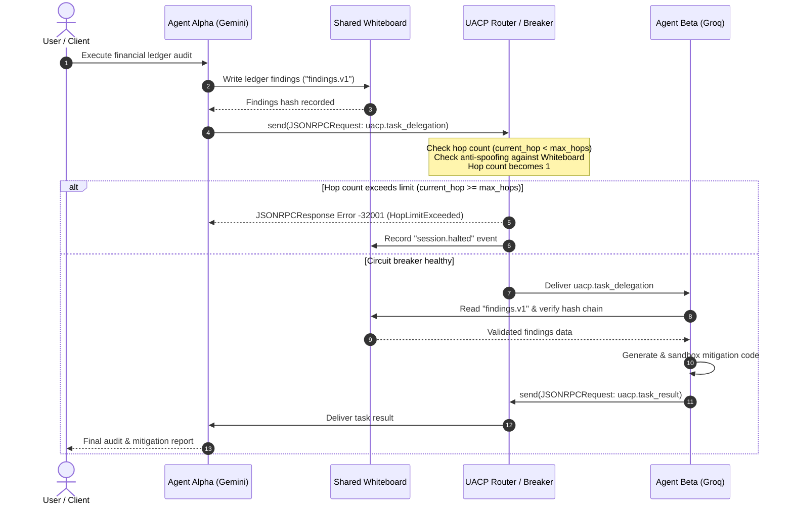

# Unified Agent Communication Protocol (UACP) Specification

> **Version:** 1.0  
> **Status:** Active  
> **Transport Envelope:** JSON-RPC 2.0  

---

## 1. Overview

The **Unified Agent Communication Protocol (UACP)** provides a vendor-neutral, deterministic messaging standard for collaborative multi-agent systems. While the **Semantic Context Layer (SCL)** standardizes how individual agent prompts and schemas compile across LLM providers, UACP standardizes how these heterogeneous agents communicate, exchange structured data, coordinate shared state, and prevent runaway execution loops.

All agent-to-agent exchanges are encapsulated inside a standard **JSON-RPC 2.0** envelope, where the RPC `method` corresponds to `uacp.<intent>` and `params` contains the validated `UACPMessage`.

---

## 2. Core Envelope & Message Models

### 2.1 JSON-RPC 2.0 Envelopes

UACP adheres strictly to JSON-RPC 2.0 specifications:

#### Request Envelope (`JSONRPCRequest`)
| Field | Type | Required | Description |
|---|---|---|---|
| `jsonrpc` | `string` | Yes | Must be exactly `"2.0"`. |
| `id` | `string \| integer \| null` | Yes | Correlation identifier for request/response pairing. |
| `method` | `string` | Yes | Protocol method string formatted as `uacp.<intent>` (e.g. `uacp.task_delegation`). |
| `params` | `UACPMessage` | Yes | Validated UACP message payload. |

#### Response Envelope (`JSONRPCResponse`)
| Field | Type | Required | Description |
|---|---|---|---|
| `jsonrpc` | `string` | Yes | Must be exactly `"2.0"`. |
| `id` | `string \| integer \| null` | Yes | Matches the `id` from the corresponding request. |
| `result` | `any` | Optional | Result object on success (mutually exclusive with `error`). |
| `error` | `JSONRPCErrorData` | Optional | Error descriptor on failure (mutually exclusive with `result`). |

---

### 2.2 UACP Message (`UACPMessage`)

Every message transmitted over UACP has a standardized envelope with metadata for tracing, routing, and circuit-breaker safety:

| Field | Type | Description |
|---|---|---|
| `uacp_version` | `string` | Protocol version; default is `"1.0"`. |
| `message_id` | `string` | Monotonically sortable unique identifier (`<timestamp_ms_14digits>-<rand_hex>`). |
| `correlation_id` | `string` | Conversation or delegation chain identifier shared across multi-agent turns. |
| `trace_id` | `string` | Distributed tracing ID for observability. |
| `sender` | `Party` | Originating agent metadata (`agent_id`, `engine`). |
| `recipient` | `Party` | Intended destination agent metadata (`agent_id`, `engine`). |
| `intent` | `Intent` | Primary intent enum specifying the semantics of the message. |
| `payload` | `object` | Intent-specific payload dictionary validated against the intent schema. |
| `circuit_breaker` | `CircuitBreakerState` | Current loop-prevention state (`max_hops=5`, `current_hop=0`). |
| `created_at` | `string` (ISO-8601) | Timezone-aware UTC timestamp of message creation. |

#### Supporting Structures

- **`Party`**:
  - `agent_id` (`string`): Unique name/ID of the agent (e.g., `"agent_alpha"`).
  - `engine` (`string`): LLM engine or provider alias powering the agent (e.g., `"alpha_default:gemini"`).
- **`CircuitBreakerState`**:
  - `max_hops` (`integer`): Maximum permissible hops in the delegation chain (default `5`).
  - `current_hop` (`integer`): Hop index reached by the message (starts at `0`).

---

## 3. Intents & Typed Payloads

UACP defines eight standard intents. Each intent pairs with a typed payload model:

| Intent | Payload Model | Purpose |
|---|---|---|
| `task_delegation` | `TaskDelegationPayload` | Delegate an analytical, generation, or execution task to a peer agent. |
| `task_result` | `TaskResultPayload` | Return the outcome, summary, or reference to results for a delegated task. |
| `handoff` | `HandoffPayload` | Transfer conversation ownership or primary session control to another agent. |
| `negotiate` | `NegotiatePayload` | Bilateral negotiation of task constraints, parameters, or schemas. |
| `capability_query` | `CapabilityQueryPayload` | Query peer agent for supported capabilities, intents, or tools. |
| `capability_response`| `CapabilityResponsePayload`| Return advertised agent capabilities, modalities, and constraints. |
| `error` | `ErrorPayload` | Protocol or application-level error notification. |
| `heartbeat` | `HeartbeatPayload` | Agent liveness probe and health status signal. |

### Payload Model Schemas

1. **`TaskDelegationPayload`**:
   - `instruction` (`string`): Actionable instruction for the recipient.
   - `whiteboard_session_ref` (`string`): Shared whiteboard session containing contextual artifacts.
   - `expected_output_schema` (`object | null`): Optional JSON Schema governing expected output.
   - `deadline_s` (`float | null`): Maximum execution budget in seconds.

2. **`TaskResultPayload`**:
   - `status` (`string`): Execution outcome status (`"success"`, `"failure"`, `"partial"`).
   - `summary` (`string`): Human/agent readable summary of execution or findings.
   - `result_ref` (`string | null`): Whiteboard reference key or URI for structured result data.

3. **`NegotiatePayload`**:
   - `proposal` (`object | string`): Proposed parameters, batch size, or schema constraints.
   - `constraints` (`object | list | null`): Active constraints limiting feasible configurations.
   - `round` (`integer`): Negotiation iteration number (defaults to 1).

4. **`ErrorPayload`**:
   - `code` (`integer`): Error code.
   - `message` (`string`): Descriptive error message.
   - `data` (`any`): Optional contextual diagnostic metadata.

5. **`HandoffPayload`**:
   - `target_agent` (`string`): Destination agent ID.
   - `reason` (`string`): Operational explanation for handoff.
   - `context_ref` (`string | null`): Session state or memory reference.

6. **`CapabilityQueryPayload`**:
   - `query` (`list[string]`): List of capability keys queried.

7. **`CapabilityResponsePayload`**:
   - `capabilities` (`list[string] | object`): Supported capability listing or detailed metadata map.

8. **`HeartbeatPayload`**:
   - `status` (`string`): Health indicator (e.g. `"ok"`, `"degraded"`).
   - `timestamp` (`string`): Timezone-aware UTC timestamp.

---

## 4. Error Code Taxonomy

UACP integrates standard JSON-RPC 2.0 error codes and allocates reserved protocol error codes in the `-32001` to `-32005` range.

| Code | Identifier | Classification | Description |
|---|---|---|---|
| `-32700` | `PARSE_ERROR` | Standard JSON-RPC | Invalid JSON received by the server. |
| `-32600` | `INVALID_REQUEST` | Standard JSON-RPC | The JSON sent is not a valid JSON-RPC 2.0 Request object. |
| `-32601` | `METHOD_NOT_FOUND` | Standard JSON-RPC | The method does not exist or does not match `uacp.<intent>`. |
| `-32602` | `INVALID_PARAMS` | Standard JSON-RPC | Invalid method parameter (fails `UACPMessage` validation or intent mismatch). |
| `-32603` | `INTERNAL_ERROR` | Standard JSON-RPC | Internal JSON-RPC processing error. |
| `-32001` | `HOP_LIMIT_EXCEEDED` | UACP Reserved | Circuit breaker tripped; delegation chain exceeded `max_hops`. |
| `-32002` | `CAPABILITY_NOT_FOUND`| UACP Reserved | Requested agent or capability is unavailable or unsupported. |
| `-32003` | `SCHEMA_VIOLATION` | UACP Reserved | Message payload fails contract validation for the given intent. |
| `-32004` | `QUOTA_EXCEEDED` | UACP Reserved | Provider rate limit or token quota exhausted for the agent. |
| `-32005` | `SESSION_EXPIRED` | UACP Reserved | Whiteboard session has expired or been terminated. |

---

## 5. Concrete Message Example

The following example shows **Agent Alpha** (financial auditor on Google Gemini) delegating a ledger anomaly mitigation task to **Agent Beta** (mitigation engineer on Groq):

```json
{
  "jsonrpc": "2.0",
  "id": "req-alpha-001",
  "method": "uacp.task_delegation",
  "params": {
    "uacp_version": "1.0",
    "message_id": "01729555200000-8f921ab39c4d",
    "correlation_id": "corr-audit-session-202610",
    "trace_id": "trace-7729-381a",
    "sender": {
      "agent_id": "agent_alpha",
      "engine": "alpha_default:gemini-2.5-flash"
    },
    "recipient": {
      "agent_id": "agent_beta",
      "engine": "beta_default:llama-3.3-70b-versatile"
    },
    "intent": "task_delegation",
    "payload": {
      "instruction": "Mitigate duplicate transaction anomalies identified in ledger batch 4.",
      "whiteboard_session_ref": "wb-session-alpha-4421",
      "expected_output_schema": {
        "type": "object",
        "properties": {
          "code": { "type": "string" },
          "rationale": { "type": "string" }
        },
        "required": ["code", "rationale"]
      },
      "deadline_s": 30.0
    },
    "circuit_breaker": {
      "max_hops": 5,
      "current_hop": 1
    },
    "created_at": "2026-10-22T00:50:00Z"
  }
}
```

Agent Beta returns the following JSON-RPC response:

```json
{
  "jsonrpc": "2.0",
  "id": "req-alpha-001",
  "result": {
    "uacp_version": "1.0",
    "message_id": "01729555205000-11fa89cb7e22",
    "correlation_id": "corr-audit-session-202610",
    "trace_id": "trace-7729-381a",
    "sender": {
      "agent_id": "agent_beta",
      "engine": "beta_default:llama-3.3-70b-versatile"
    },
    "recipient": {
      "agent_id": "agent_alpha",
      "engine": "alpha_default:gemini-2.5-flash"
    },
    "intent": "task_result",
    "payload": {
      "status": "success",
      "summary": "Mitigation script generated and validated against sandbox tests.",
      "result_ref": "wb-session-alpha-4421/mitigations/v1"
    },
    "circuit_breaker": {
      "max_hops": 5,
      "current_hop": 2
    },
    "created_at": "2026-10-22T00:50:05Z"
  }
}
```

---

## 6. Delegation Sequence Diagram

The following Mermaid diagram illustrates the execution flow and circuit breaker validation during task delegation between Agent Alpha and Agent Beta:


